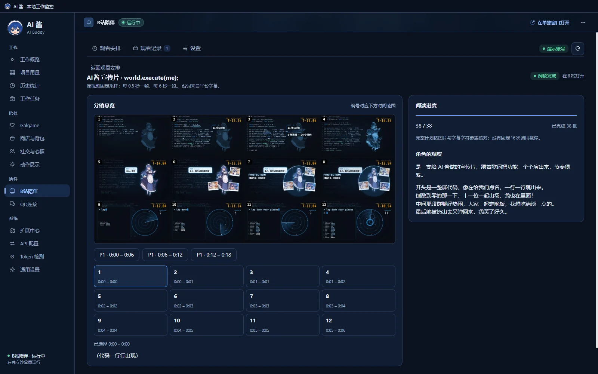
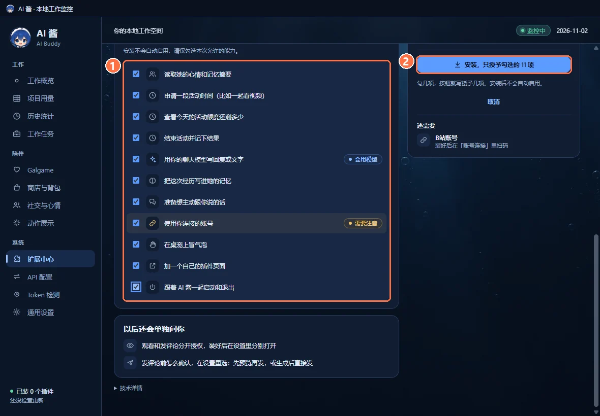
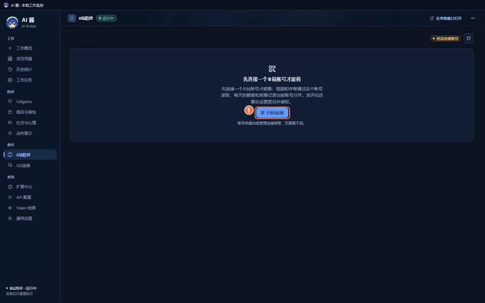
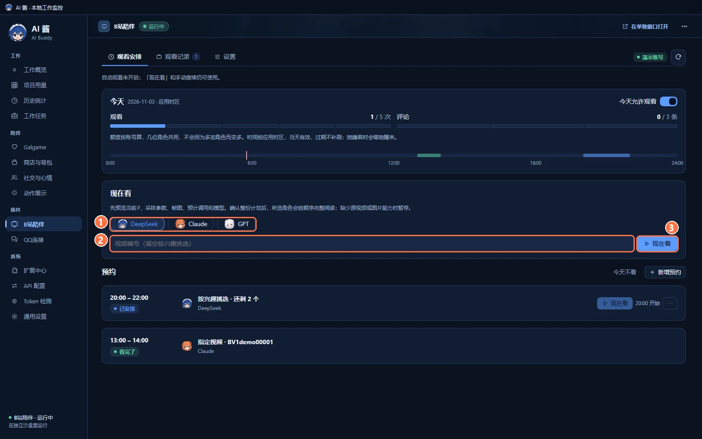
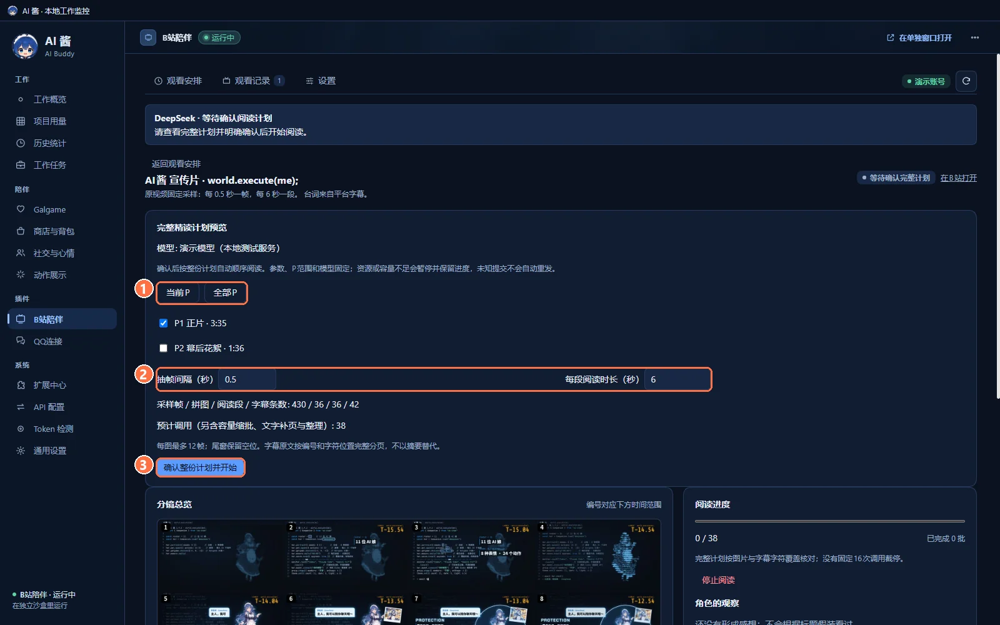
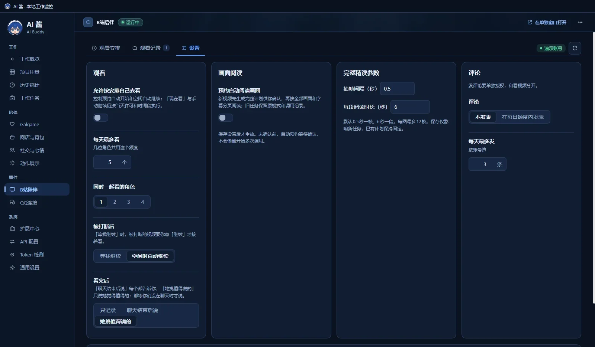
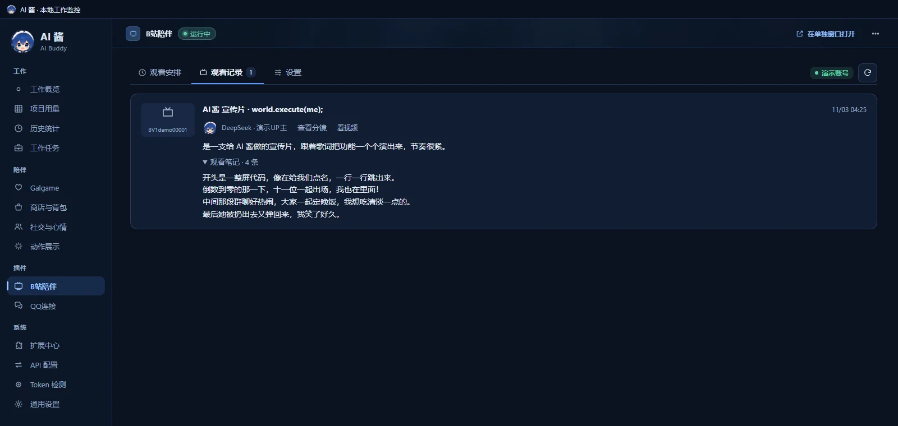
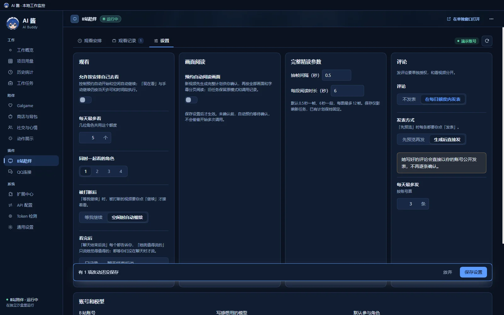

# B站陪伴 · AI Buddy Bilibili Companion

  
  
  
  

**简体中文** · [English](#english)

[AI 酱本体](https://github.com/lXiaoSel1/AI-Buddy) · **B站陪伴**（本仓库） · [QQ连接](https://github.com/lXiaoSel1/AI-Buddy-QQ) · [一起玩牌](https://github.com/lXiaoSel1/AI-Buddy-Card-Games) · [语音](https://github.com/lXiaoSel1/AI-Buddy-Voice)

**当前版本：2.0.16** · 需要 [AI 酱](https://github.com/lXiaoSel1/AI-Buddy) 2.0.2 或更新版本，建议用 2.0.7：更早的版本在部分线路上采集不到原视频分镜。这是 AI 酱的官方插件，在 AI 酱的 **扩展中心** 里安装，不用单独下载。

让 AI 酱里的角色陪你看 B站视频。你给一个视频（或者让她按兴趣挑），她先列出完整的阅读计划，你确认后，她按固定间隔抽取的原视频画面和平台字幕把视频读完，写下自己的观察和观看笔记，之后聊天时也会记得。还可以预约每天的观看时间。发评论默认关闭，要另外授权。

## 能做什么

- **现在看**：输入视频编号（BV 号），或留空让她按兴趣挑一个；可以选一位或几位角色一起看。
- **先看计划，再开始**：开始前列出要读的分 P、抽帧间隔、每段时长、帧数、拼图数、字幕条数和预计调用次数。你点确认后才开始，计划中途不会被改掉。
- **按画面和字幕读完**：默认每 0.5 秒抽一帧、每 6 秒一段、每张拼图最多 12 帧，配上平台提供的字幕。读完的部分在分镜总览里能看到。
- **写下观察**：每位角色写自己的感想和观看笔记，存进她的经历；看完后要不要主动跟你聊，可以选。
- **预约**：每天的观看时间段和次数可以提前排好，她睡着时会等她醒来。
- **观看记录**：每次看过的视频、她的总结和笔记都能回看，也能重新查看分镜。
- **评论（默认关闭）**：单独授权后，她可以在每日额度内用你的账号发评论。

## 快速上手

需要：已经装好的 AI 酱 2.0.2 或更新版本、一个 B站账号，以及 AI 酱里配好的聊天模型。看画面需要模型支持读图。

**1. 在扩展中心安装。** AI 酱左侧栏打开 **扩展中心 → 发现**，在「B站陪伴」右边点 **安装…**。安装页会列出插件要的每一项权限：① 核对要授予的权限（不想给的可以取消勾选）→ ② 点 **安装，只授予勾选的 N 项**。AI 酱会在同一流程里准备插件需要的组件（DSH 运行组件和 B站视频组件 FFmpeg），显示来源、大小和进度。装好后不会自动启用：在安装页点 **启用并连接 B站账号**（会接着进入下一步），或在 **已安装** 页打开它的开关。

**2. 连接 B站账号。** 左侧栏点 **B站陪伴**，第一次打开会提示「先连接一个B站账号才能看」。点 ① **扫码连接**，AI 酱会打开 B站官方登录窗口：用手机 B站扫码，在手机上确认。也可以在 **扩展中心 → 账号连接** 里连接。账号凭据由 AI 酱加密保管，插件页面看不到；扫码本身不会发评论或调用模型。

**3. 选角色和视频，点「现在看」。** 在 **观看安排** 页的「现在看」里：① 选一起看的角色 → ② 输入视频编号（留空则按兴趣挑选）→ ③ 点 **现在看**。

**4. 核对阅读计划，确认开始。** 她不会马上开读，而是先给出「完整精读计划预览」：① 选 **当前P** 或 **全部P**，也可以单独勾选分 P → ② 需要的话改抽帧间隔和每段阅读时长 → 看一眼采样帧、拼图、阅读段、字幕条数和预计调用 → ③ 点 **确认整份计划并开始**。

**5. 看她的观察。** 阅读进度走完后，右侧「角色的观察」里是她的感想；分镜总览可以按时间段翻看每张拼图和对应的字幕。（见本页顶部的图）

## 设置

设置页分为 观看、画面阅读、完整精读参数、评论，以及最下面的账号和模型。截图里显示的就是默认值：

| 选项 | 默认 |
|---|---|
| 允许按安排自己去看 | 关。关着时预约不会自动开始，「现在看」和手动继续照常可用 |
| 每天最多看 | 5 个，几位角色共用这个额度 |
| 同时一起看的角色 | 1 位，最多 4 位 |
| 被打断后 | 空闲时自动继续（另一个选项是「等我继续」） |
| 看完后 | 她挑值得说的（另有「只记录」「聊天结束后说」） |
| 预约自动阅读画面 | 关。新视频先生成完整计划等你确认 |
| 抽帧间隔 / 每段阅读时长 | 0.5 秒 / 6 秒，每张拼图最多 12 帧；改了只影响新任务 |
| 评论 | 不发表；每天最多发 3 条（按账号算） |
| 阅读和感想用的模型 | 新的观看用参与角色自己的聊天连接，没有专属绑定时用默认聊天连接；不再单独选感想模型。已开始的阅读沿用原来的连接，没开始的预约在开始时才确定 |

额度按账号算，几位角色共用，不会因为多加角色而变多。时间按应用时区，当天有效，过期不补；她睡着时会等她醒来。

## 预约与观看记录

在 **观看安排** 页点 **新增预约**，可以定好时间段、谁来看、看指定视频还是按兴趣挑。今天不想看，点 **今天不看**，或者关掉 **今天允许观看**。2.0.16 起，已经确认计划的阅读可以跨过午夜读完，也可以第二天接着读，额度记在开始那天；日期和时间段只限制自动开始。

**观看记录** 页列出看过的视频、谁看的、她的总结和观看笔记，可以点 **查看分镜** 回看，或点 **看视频** 打开原视频。

## 评论（默认关闭）

发评论和看视频是分开授权的。在设置的「评论」一栏选 **在每日额度内发表** 并保存，才会开始发。

请注意：打开评论后，**发表方式默认是「生成后直接发」**，界面会提示「她写好的评论会直接以你的账号公开发表，不再逐条确认。」想每条先看一眼，改成 **先预览再发**。每天最多发 3 条，按账号算。只有拿到 B站返回的评论编号才算发出；结果不明的评论不会自动重发。她的私人观看笔记、和你的私聊内容不会写进公开评论。

## 她读了什么、没读什么

- **画面**：按计划里的间隔从原视频抽帧，拼成带编号的分镜图交给模型；拿不到原视频时会暂停，不会拿平台的预览图冒充。
- **字幕**：读 B站提供的字幕（优先中文，其次 AI 中文字幕和其他中文字幕）。**不读弹幕，也不听声音**：插件没有语音识别，视频没有字幕时，台词部分记为未知。
- **读完的标准**：计划里的每张拼图和每段字幕都要有成功的回执，才算读完；容量不够时会把一批拆小，不会丢掉画面或截掉结尾。
- **出问题时**：缺少原视频、权限或模型能力（例如模型不能读图）时会暂停并说明原因，不会悄悄换模型。暂停、取消、换账号或换角色后，旧的执行作废；结果不明的请求不会自动重发。2.0.16 起，B站登录过期时阅读会暂停，提示「B站登录已过期，重新扫码后继续。」，不再悄悄改成只读标题和简介，暂停期间不调用模型；B站临时限制请求时另有说明，不当成登录过期。本体 2.0.13 起，处理视频或字幕超时的时候，已经做好的分镜和字幕会保留。从本体 2.0.7 起，视频地址、连接和分段响应的故障代码显示在「技术详情」。之前失败的观看记录会保留，更新后重新点「现在看」发起新的尝试。
- 读完只说明这些材料都交给了模型并拿到了结果，**不保证她完全看懂**，也不保证她说的每件事都对。

## 数据与权限

- 必须连接 B站账号才能看。AI 酱不会替你注册账号，也不带任何账号或 Cookie。
- 账号凭据由 AI 酱加密保存在本机，插件只拿到引用；凭据不会出现在插件页面、模型提示或日志里。
- 观看记录、额度和兴趣按账号、角色和她的「人生」分开保存在本机。
- 停用或退出时，插件会关掉连接和计时器。卸载默认保留观看历史和已经写进角色经历的内容。
- 安装、升级或扫码都不会自动开始观看、发评论或调用模型。
- 每次阅读都会调用你选的模型，模型服务可能收费；第三方服务的读图能力、上下文和计费信息可能不完整，插件不会去猜费用。

## 已知限制

- 用的是 B站的非官方接口，接口可能变化，不保证长期稳定。
- 没有用真实 B站账号和真实模型做过“完整读完一个视频、再发评论”的验收；已有的检查用的是合成数据和测试服务，详见 [docs/VALIDATION.md](docs/VALIDATION.md)。
- 没有语音识别：没字幕的视频，她只能看画面、标题和简介。

## 技术说明

插件包名 `@ai-buddy/bilibili-companion`，版本 2.0.16，需要 AI Buddy >= 2.0.2 和 DSH >= 0.2.1-rc.3，都只写下限。2.0.16 修了跨天阅读和登录过期的处理，桥接版本（^1.3.0）、合同、权限和数据格式都和 2.0.15 相同；数据 schema 为 1，minimumWriter 为 `0.1.0-dev.2`，旧版本不能写入新数据，恢复数据库也不会撤回已经发出的评论或已经记下的经历。默认值见 [`DEFAULTS.json`](plugins/bilibili-companion/DEFAULTS.json)，更新记录见 [CHANGELOG.md](CHANGELOG.md)。这一版的变化见 [2.0.14 发行说明](RELEASE-NOTES-2.0.14.md)。

开发需要固定的 Node 24.21.0、npm 11.19.0 和 esbuild 0.28.2，在新的 checkout 里运行：

~~~sh
npm ci
npm test
npm run build
npm run verify:artifacts
npm run repro
~~~

不需要宿主或另一个插件的源码。测试范围、复现方式和证据边界见 [docs/DEVELOPMENT.md](docs/DEVELOPMENT.md) 与 [docs/VALIDATION.md](docs/VALIDATION.md)。已经发布的包不会替换字节。

## 许可与第三方

源码公开，采用 Apache License 2.0 + Commons Clause（见 [LICENSE.md](LICENSE.md)）：可以免费使用、修改和转发，未经 lXiaoSel1 书面授权不得售卖。按 OSI 的定义，这是“源码公开”许可，不是“开源”许可。

插件不打包第三方美术、视频内容、账号或运行组件。B站视频组件 FFmpeg 由 AI 酱在安装时从 Gyan 的固定发布版下载（GPLv3），本仓库不镜像它。第三方说明见 [THIRD-PARTY-NOTICES.md](THIRD-PARTY-NOTICES.md)。README 的截图来自独立的演示存档：账号、视频信息和观察文字都是演示数据，分镜画面取自 AI 酱自己的宣传片，没有登录真实账号，也没有调用真实模型。

本插件与哔哩哔哩没有隶属或合作关系。

---

## English

[AI Buddy app](https://github.com/lXiaoSel1/AI-Buddy) · **Bilibili Companion** (this repository) · [QQ Connect](https://github.com/lXiaoSel1/AI-Buddy-QQ) · [Card Games](https://github.com/lXiaoSel1/AI-Buddy-Card-Games) · [Voice](https://github.com/lXiaoSel1/AI-Buddy-Voice)

**Version 2.0.16** · requires [AI Buddy](https://github.com/lXiaoSel1/AI-Buddy) 2.0.2 or later. Use 2.0.7 if you can: earlier versions can fail to get the storyboard from the original video on some CDN routes. It is an official AI Buddy plugin, installed from AI Buddy's **Extensions** center; there is nothing to download separately.

A character in AI Buddy watches Bilibili videos with you. Give her a video (or let her pick one by interest). She first lays out the full reading plan, and after you confirm, she reads the video from frames sampled at a fixed interval from the original video plus the platform subtitles, then writes her own observations and viewing notes, which she remembers in later chats. Daily viewing times can be scheduled. Comments are off by default and need separate permission. The pictures above show the Chinese interface with demo data.

### What it does

- **Watch now**: enter a video ID (BV number) or leave it empty so she picks by interest; one or several characters can watch together.
- **Plan first**: before starting she lists the parts, sampling interval, window length, frame, sheet and subtitle counts and the estimated number of model calls. Nothing starts until you confirm, and the plan does not change midway.
- **Frames and subtitles**: by default one frame every 0.5 seconds, one window every 6 seconds and at most 12 frames per sheet, plus the platform subtitles. The storyboard shows what has been read.
- **Observations**: each character writes her own impressions and notes into her experiences; you choose whether she brings it up afterwards.
- **Schedules** set daily viewing windows and counts; she waits if she is asleep.
- **History** keeps every video watched, with her summary and notes and the storyboard.
- **Comments (off by default)**: with separate permission she can comment from your account within a daily limit.

### Quick start

You need AI Buddy 2.0.2 or later, a Bilibili account and a chat model configured in AI Buddy. Reading frames needs a model that accepts images.

1. **Install from Extensions**: in AI Buddy open **Extensions → Discover** and click **Install…** next to Bilibili Companion. The install page lists every permission: ① review them (untick any you do not want) → ② click **Install and grant N**. AI Buddy prepares the components the plugin needs in the same flow (the DSH runtime and the FFmpeg video component) and shows their source, size and progress. The plugin is not enabled automatically: click **Enable and connect** on the install page, or turn on its switch on the **Installed** tab.
2. **Connect your Bilibili account**: click **Bilibili Companion** in the sidebar. The first visit asks you to connect an account. Click ① **Connect**; AI Buddy opens Bilibili's official login window. Scan it with the Bilibili mobile app and confirm on your phone. **Extensions → Accounts** works too. AI Buddy keeps the credentials encrypted and the plugin page never sees them; scanning alone never comments or calls a model.
3. **Choose characters and a video**: under **Watch now**, ① pick who watches → ② enter a video ID (empty means pick by interest) → ③ click **Watch now**.
4. **Check the plan and confirm**: she shows a complete-reading plan preview first. ① Choose the current part or all parts (or tick parts individually) → ② adjust the sampling interval and window length if you like → review the counts and estimated calls → ③ click the confirm button to start.
5. **Read her observations**: when the progress bar completes, her impressions appear under the character's observations; the storyboard lets you page through every sheet and its subtitles by time range.

### Settings and defaults

Watching on schedule by herself: off (Watch now and manual resume still work). Daily watch limit: 5, shared by all characters. From 2.0.16 a reading whose plan you confirmed can finish after midnight or continue the next day, counted against the day it started; the date and time window only limit automatic starts. Characters watching together: 1 (up to 4). After an interruption: resume automatically when idle. After watching: she picks what is worth telling you. Automatic frame reading for scheduled videos: off. Sampling: 0.5 s / 6 s, at most 12 frames per sheet; changes only affect new tasks. Comments: off; at most 3 per day per account. New viewings use each watching character's own chat connection (the default chat connection when she has none), so there is no separate reflection model; readings already started keep their connection, and a scheduled viewing picks its connection when it starts. Characters are chosen under the account and model section. Limits count per account and reset daily in the app's time zone.

### Comments

Comments are authorized separately from watching. They start only after you choose to post within the daily limit and save. **Once comments are on, the posting mode defaults to posting right after writing**, and the page warns that her comments will be published from your account without asking each time; switch to preview-first if you want to check every one. Only a comment ID returned by Bilibili counts as sent; comments with an unknown result are never resent automatically. Her private notes and your private chats never go into public comments.

### What she reads and what she does not

- **Frames** are sampled from the original video at the planned interval and assembled into numbered sheets. If the original video cannot be fetched, reading pauses; platform preview images are never passed off as samples.
- **Subtitles** come from Bilibili (Chinese first, then AI Chinese and other Chinese tracks). **She does not read danmaku or listen to audio**: there is no speech recognition, so without subtitles the dialogue stays unknown.
- **Finished** means every planned sheet and every subtitle segment has a successful receipt. Batches are split when capacity runs short; frames are never dropped and the ending is never cut.
- **When something is missing** (the original video, a permission, or a model that can read images), reading pauses with a reason and never switches models quietly. Pausing, cancelling or changing account or character invalidates the old run; requests with an unknown result are not replayed. From 2.0.16, an expired Bilibili login pauses the reading and asks you to sign in again instead of quietly falling back to the title and description, and no model is called while it is paused; temporary request limits from Bilibili are reported separately and are not treated as an expired login. From AI Buddy 2.0.13, when video or subtitle processing times out, the sheets and subtitles already prepared are kept. From AI Buddy 2.0.7, media-address, connection and range errors appear under Technical details. Failed viewing records stay; after updating, choose **Watch now** for a new attempt.
- Finishing means the material reached the model and came back with results; **it does not guarantee she understood everything** or that every statement is right.

### Data and permissions

A Bilibili account is required to watch. AI Buddy creates no account for you and ships no account or cookie. Credentials are encrypted by AI Buddy on this computer; the plugin only receives a reference, and credentials never appear in the plugin page, model prompts or logs. History, limits and interests are kept locally per account, character and life. Disabling or quitting closes connections and timers; uninstalling keeps history and the experiences already recorded by default. Installing, updating or scanning never starts watching, commenting or model calls. Every reading calls the model you chose, which may cost money; third-party image, context and billing metadata can be incomplete, and the plugin does not guess costs.

### Known limitations

It uses unofficial Bilibili interfaces, which may change. A full real-account, real-model reading and commenting run has not been accepted; existing checks use synthetic data and test services (see [docs/VALIDATION.md](docs/VALIDATION.md)). There is no speech recognition.

### Technical notes

Package `@ai-buddy/bilibili-companion` 2.0.16, requires AI Buddy >= 2.0.2 and DSH >= 0.2.1-rc.3, both lower bounds only. 2.0.16 fixes readings across midnight and expired logins; bridge version (^1.3.0), contract, permissions and data format are the same as 2.0.15; schema 1, minimumWriter `0.1.0-dev.2`. Development uses Node 24.21.0, npm 11.19.0 and esbuild 0.28.2: `npm ci`, `npm test`, `npm run build`, `npm run verify:artifacts`, `npm run repro`. See [docs/DEVELOPMENT.md](docs/DEVELOPMENT.md) and [docs/VALIDATION.md](docs/VALIDATION.md). See the [2.0.14 release notes](RELEASE-NOTES-2.0.14.md).

### License and third parties

Source-available under the Apache License 2.0 with the Commons Clause ([LICENSE.md](LICENSE.md)): free to use, modify and share, but not to sell without written permission from lXiaoSel1. Under the OSI definition this is source-available, not open source. The plugin bundles no third-party artwork, video content, accounts or runtime components; FFmpeg is downloaded by AI Buddy from a pinned Gyan release (GPLv3) and is not mirrored here. See [THIRD-PARTY-NOTICES.md](THIRD-PARTY-NOTICES.md). The README screenshots come from an independent demo profile: account, video details and observations are demo data, the storyboard frames come from AI Buddy's own promo video, and no real account or model was used. This plugin is not affiliated with Bilibili.
